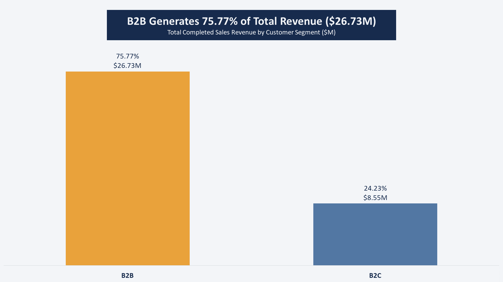
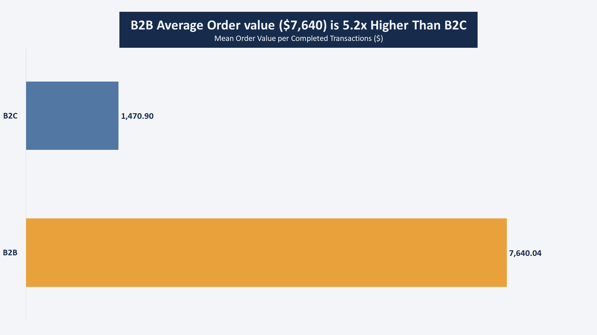
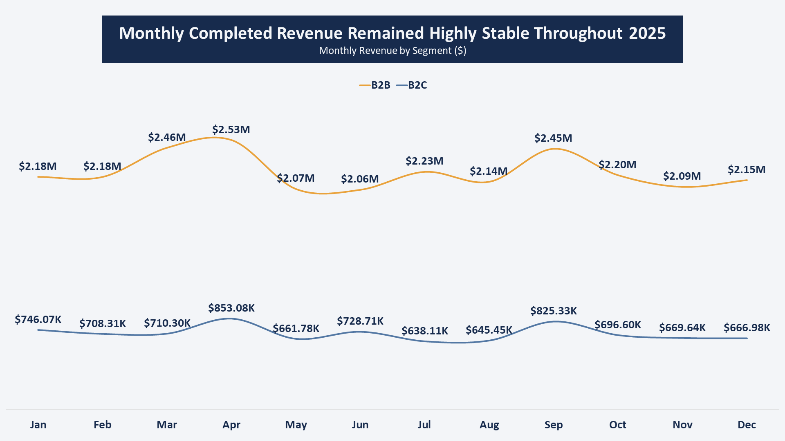
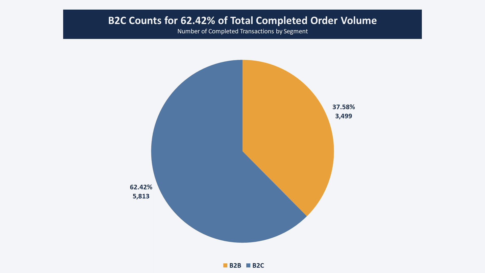

# **Customer Revenue Concentration & Purchasing Regularity Analysis**
## **One Question Projects — Project 07**

## **Project Overview**
This project analyzes customer revenue concentration for a fictional company serving both Business-to-Business (B2B) and Business-to-Consumer (B2C) customers.

The analysis examines how revenue is distributed across the customer base and investigates whether the company's reliance on a limited number of customers may create commercial risk when their purchasing activity is irregular.

Rather than focusing solely on the traditional 80/20 Pareto principle, the project combines revenue concentration analysis with customer purchasing regularity to develop actionable insights for customer relationship management and retention prioritization.

## **Business Problem**
A company can generate strong overall revenue while remaining heavily dependent on a relatively small number of customers. However, revenue concentration alone does not necessarily indicate a business problem.

The level of risk may also depend on how consistently these customers generate revenue over time. Customers contributing substantial revenue through irregular purchasing activity may require a different level of commercial attention than customers with similarly high revenue contributions but more consistent purchasing patterns.

Without understanding both revenue concentration and purchasing regularity, management may struggle to identify which customer relationships deserve closer monitoring and where retention efforts should be prioritized.

## **Project Goal**
The goal of this project is to evaluate customer revenue concentration and assess how purchasing regularity helps interpret the commercial significance of major revenue contributors.

The analysis aims to:
- Measure the share of total revenue generated by the company's largest customers.
- Determine how many customers account for 50% and 80% of total revenue.
- Examine the relationship between individual customer revenue and the number of active purchasing months.
- Identify high-revenue customers whose purchasing patterns may warrant further commercial review.
- Develop evidence-based recommendations for customer relationship management and retention prioritization.

## **Project Business Question**
**Does the company's reliance on a limited number of customers create a potential commercial risk due to irregular revenue contributions, and which customers should receive priority in retention efforts?**

The analysis addresses this question through two complementary perspectives:
- **Revenue Concentration:** How dependent is the company on a relatively small proportion of its active customers?
- **Purchasing Regularity:** Do major revenue contributors purchase consistently throughout the year, or is their contribution concentrated in a limited number of months?

## **Executive Summary**
**NO NUMMARY YET**

## **Dataset Description**
The dataset contains approximately 10,000 sales orders from a company serving both B2B and B2C customers over a 12-month period in 2025. It consists of 6 columns covering order identifiers, customer identifiers, order dates, order values, order statuses, and customer segments.

The dataset supports the analysis of Customer Revenue Concentration and Purchasing Regularity, helping assess the company's reliance on a limited number of customers and identify high-revenue customers whose purchasing patterns may warrant further commercial investigation and retention prioritization.

| Column | Description |
| ------ | ----------- |
| order_id | Unique identifier for each order. |
| customer_id | Unique identifier for the customer placing the order. |
| order_date | Date on which the order was placed. |
| order_value | Monetary value of the order, expressed in Egyptian pounds (EGP). |
| order_status | Order status: Completed or Cancelled. |
| customer_segment | Customer classification: B2B or B2C. |

## **EDA & Baseline KPIs**
The initial exploratory analysis established a baseline view of the company's sales activity and customer base for 2025. The dataset contains **9,799 orders**, of which **9,312 were completed**, generating total revenue of **EGP 35.28 million**. The overall cancellation rate was **4.97%**.

The customer base includes **949 distinct customers**, with **946 active customers** who placed at least one completed order during the analysis period. The average order value was **EGP 3,788.97**, providing an initial reference point for evaluating sales performance.

These baseline KPIs establish the starting point for the next stage of analysis. Further exploration will examine relevant data distributions before focusing on customer-level revenue contributions, cumulative revenue concentration, and purchasing regularity.

### **B2B Generates 75.77% of Total Revenue ($26.73M)**

- **B2B** customers generate the majority of total revenue, contributing **75.77% ($26.73M)**, while **B2C** customers account for the remaining **24.23% ($8.55M)**. This highlights the company's strong reliance on its B2B customer segment for revenue generation.

### **B2B Average Order value ($7,640) is 5.2x Higher Than B2C**

- **B2B** customers have a significantly higher average order value of **$7,640.04**, compared to **$1,470.90** for **B2C** customers. This indicates that **B2B** orders contribute substantially more revenue per transaction, despite representing a smaller customer segment.

### **Monthly Completed Revenue Remained Highly Stable Throughout 2025**

- **B2B** revenue consistently exceeded **B2C** revenue across all 12 months, with monthly **B2B** contributions ranging from **$2.06M to $2.53M**. Both segments maintained relatively stable revenue patterns throughout the year, with **B2B** showing stronger monthly contributions and more noticeable peaks in **March, April, and September**.

### **B2C Counts for 62.42% of Total Completed Order Volume**

- **B2C** customers account for the majority of completed orders, representing **62.42% (5,813 orders)**, compared to **37.58% (3,499 orders)** for B2B. Despite generating a smaller share of total orders, B2B contributes a substantially higher share of revenue, reflecting its much higher average order value.

## **Analysis**

### Analytical Approach & Scope
To answer the business question, the analysis focuses on customer-level revenue contributions and purchasing activity rather than individual transactions. Customer-level analysis was selected to identify how revenue is distributed across the customer base and whether high-revenue customers maintain purchasing activity throughout the year. The analytical population consists of 946 active customers who placed at least one completed order during 2025, with all customer-level metrics calculated using completed orders only. Each customer represents one observation in the analysis, with total revenue, completed order count, and active months used as the primary analytical measures.