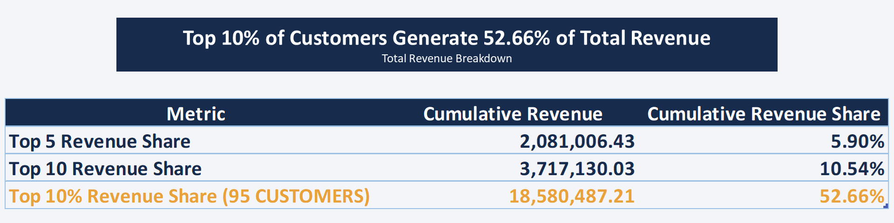
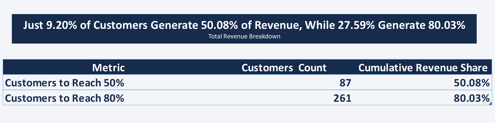
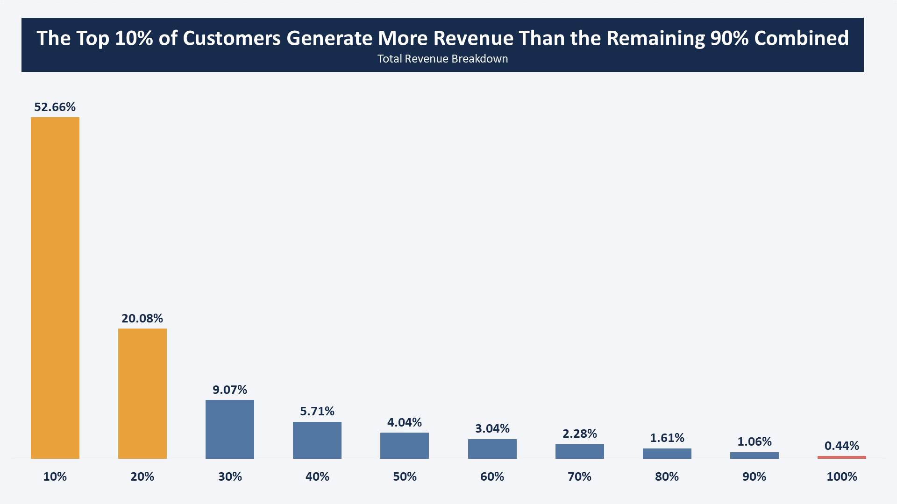
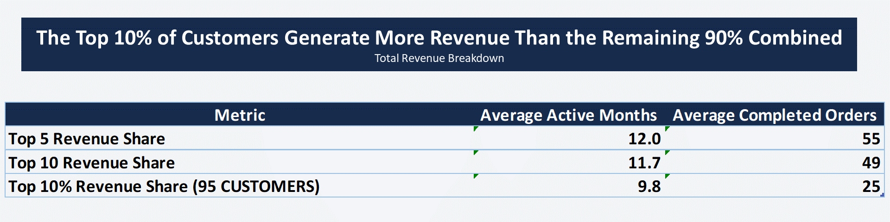
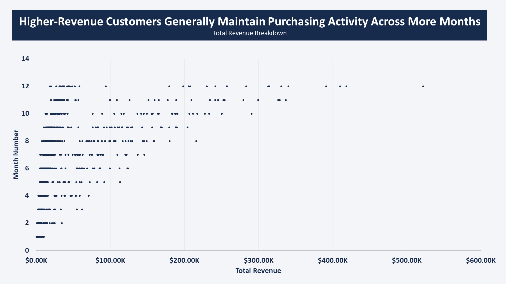

# **Customer Revenue Concentration & Purchasing Regularity Analysis**
## **One Question Projects — Project 07**

## **Project Overview**
This project analyzes customer revenue concentration for a fictional company serving both Business-to-Business (B2B) and Business-to-Consumer (B2C) customers.

The analysis examines how revenue is distributed across the customer base and investigates whether the company's reliance on a limited number of customers may create commercial risk when their purchasing activity is irregular.

Rather than focusing solely on the traditional 80/20 Pareto principle, the project combines revenue concentration analysis with customer purchasing regularity to develop actionable insights for customer relationship management and retention prioritization.

## **Business Problem**
A company can generate strong overall revenue while remaining heavily dependent on a relatively small number of customers. However, revenue concentration alone does not necessarily indicate a business problem.

The level of risk may also depend on how consistently these customers generate revenue over time. Customers contributing substantial revenue through irregular purchasing activity may require a different level of commercial attention than customers with similarly high revenue contributions but more consistent purchasing patterns.

Without understanding both revenue concentration and purchasing regularity, management may struggle to identify which customer relationships deserve closer monitoring and where retention efforts should be prioritized.

## **Project Goal**
The goal of this project is to evaluate customer revenue concentration and assess how purchasing regularity helps interpret the commercial significance of major revenue contributors.

The analysis aims to:
- Measure the share of total revenue generated by the company's largest customers.
- Determine how many customers account for 50% and 80% of total revenue.
- Examine the relationship between individual customer revenue and the number of active purchasing months.
- Identify high-revenue customers whose purchasing patterns may warrant further commercial review.
- Develop evidence-based recommendations for customer relationship management and retention prioritization.

## **Project Business Question**
**Does the company's reliance on a limited number of customers create a potential commercial risk due to irregular revenue contributions, and which customers should receive priority in retention efforts?**

The analysis addresses this question through two complementary perspectives:
- **Revenue Concentration:** How dependent is the company on a relatively small proportion of its active customers?
- **Purchasing Regularity:** Do major revenue contributors purchase consistently throughout the year, or is their contribution concentrated in a limited number of months?

## **Executive Summary**
**This analysis examines whether the company's revenue concentration among a limited number of customers represents a potential commercial risk, and how purchasing activity can help identify customers who may require greater retention attention.**

**The analysis covers 9,312 completed orders from 946 active customers during 2025, with a total completed revenue of $35.28M. Customer-level revenue contributions and purchasing activity were examined to understand the distribution of revenue and the purchasing patterns of high-value customers.**

**The findings reveal a significant concentration of revenue, with the top 10% of active customers (95 customers) generating 52.66% of total revenue, while only 261 customers (27.59% of the active customer base) account for 80.03%. Further analysis shows that the highest-revenue customers generally maintain purchasing activity across more months and place more completed orders throughout the year. The customer-level distribution also highlights a substantial gap between the highest-value segment and the remaining customer base.**

**Overall, the findings indicate a considerable reliance on a relatively small group of high-value customers. However, sustained purchasing activity among these customers suggests that revenue concentration alone should not be interpreted as evidence of immediate retention risk. The analysis therefore recommends prioritizing high-value customer retention, monitoring changes in purchasing activity, investigating customers with high revenue but limited purchasing activity, and developing broader customer segmentation strategies to support a more balanced revenue base.**

## **Dataset Description**
The dataset contains approximately 10,000 sales orders from a company serving both B2B and B2C customers over a 12-month period in 2025. It consists of 6 columns covering order identifiers, customer identifiers, order dates, order values, order statuses, and customer segments.

The dataset supports the analysis of Customer Revenue Concentration and Purchasing Regularity, helping assess the company's reliance on a limited number of customers and identify high-revenue customers whose purchasing patterns may warrant further commercial investigation and retention prioritization.

| Column | Description |
| ------ | ----------- |
| order_id | Unique identifier for each order. |
| customer_id | Unique identifier for the customer placing the order. |
| order_date | Date on which the order was placed. |
| order_value | Monetary value of the order, expressed in Egyptian pounds (EGP). |
| order_status | Order status: Completed or Cancelled. |
| customer_segment | Customer classification: B2B or B2C. |

## **EDA & Baseline KPIs**
The initial exploratory analysis established a baseline view of the company's sales activity and customer base for 2025. The dataset contains **9,799 orders**, of which **9,312 were completed**, generating total revenue of **EGP 35.28 million**. The overall cancellation rate was **4.97%**.

The customer base includes **949 distinct customers**, with **946 active customers** who placed at least one completed order during the analysis period. The average order value was **EGP 3,788.97**, providing an initial reference point for evaluating sales performance.

These baseline KPIs establish the starting point for the next stage of analysis. Further exploration will examine relevant data distributions before focusing on customer-level revenue contributions, cumulative revenue concentration, and purchasing regularity.

### **B2B Generates 75.77% of Total Revenue ($26.73M)**

- **B2B** customers generate the majority of total revenue, contributing **75.77% ($26.73M)**, while **B2C** customers account for the remaining **24.23% ($8.55M)**. This highlights the company's strong reliance on its B2B customer segment for revenue generation.

### **B2B Average Order value ($7,640) is 5.2x Higher Than B2C**

- **B2B** customers have a significantly higher average order value of **$7,640.04**, compared to **$1,470.90** for **B2C** customers. This indicates that **B2B** orders contribute substantially more revenue per transaction, despite representing a smaller customer segment.

### **Monthly Completed Revenue Remained Highly Stable Throughout 2025**

- **B2B** revenue consistently exceeded **B2C** revenue across all 12 months, with monthly **B2B** contributions ranging from **$2.06M to $2.53M**. Both segments maintained relatively stable revenue patterns throughout the year, with **B2B** showing stronger monthly contributions and more noticeable peaks in **March, April, and September**.

### **B2C Counts for 62.42% of Total Completed Order Volume**

- **B2C** customers account for the majority of completed orders, representing **62.42% (5,813 orders)**, compared to **37.58% (3,499 orders)** for B2B. Despite generating a smaller share of total orders, B2B contributes a substantially higher share of revenue, reflecting its much higher average order value.

## **Analysis**

### Analytical Approach & Scope
To answer the business question, the analysis focuses on customer-level revenue contributions and purchasing activity rather than individual transactions. Customer-level analysis was selected to identify how revenue is distributed across the customer base and whether high-revenue customers maintain purchasing activity throughout the year. The analytical population consists of 946 active customers who placed at least one completed order during 2025, with all customer-level metrics calculated using completed orders only. Each customer represents one observation in the analysis, with total revenue, completed order count, and active months used as the primary analytical measures.

### **Revenue Contribution Among Top Customers**

- Revenue contribution is significantly concentrated among the company's highest-value customers. **The top 5 customers account for 5.90% of total revenue**, while the **top 10 contribute 10.54%**. More notably, the **top 10% of active customers (95 customers) generate 52.66% of total revenue**. This highlights a substantial imbalance in revenue contributions across the customer base, with a relatively small group of customers accounting for more than half of the company's revenue.

### **Customer Concentration Thresholds**

- A relatively small proportion of the active customer base accounts for the majority of total revenue. Only **87 customers (9.20% of active customers)** are needed to generate **50.08% of total revenue**, while **261 customers (27.59%)** account for **80.03%**. This indicates that the company's revenue is heavily dependent on a limited segment of its customer base, making the purchasing behavior and retention of these high-value customers important areas for further investigation.

### **Revenue distribution by Customer Deciles**

- Revenue distribution across customer deciles reveals a sharp decline in revenue contribution from the highest-value segment to the lowest. The top **10% of customers** generate **52.66% of total revenue**, exceeding the combined contribution of the remaining 90% (47.34%). **The second decile contributes another 20.08%**, bringing the cumulative contribution of **the top 20% to 72.74%**. Revenue contribution continues to decline across subsequent deciles, with **the bottom 10% accounting for only 0.44% of total revenue**. This highlights the substantial gap in revenue contribution between the highest-value customers and the rest of the customer base.

### **Purchasing Activity Among High-Value Customers**

- High-value customers generally demonstrate sustained purchasing activity throughout the year. **The top 5 customers average 12 active months** and **55 completed orders**, while **the top 10 average 11.7 active months and 49 completed orders**. For **the top 10% of customers (95 customers), the averages decrease to 9.8 active months and 25 completed orders**. These findings suggest that the highest-revenue customers tend to maintain more frequent purchasing activity across the year. However, group averages may conceal individual differences and do not necessarily indicate consistent intervals between purchases.

### **Customer Revenue vs. Purchasing Activity**

- **The scatter plot reveals that most customers are concentrated in the low-revenue range, with many maintaining purchasing activity across a relatively high number of months. A smaller group of customers combines low revenue with activity in fewer months, while only a limited number of customers generate significantly higher revenue, generally with activity spread across more months. This suggests that higher-value customers tend to demonstrate broader purchasing activity throughout the year, although the distribution does not establish a direct or causal relationship between revenue and purchasing regularity.**

## **Conclusion**
**The analysis reveals a significant concentration of revenue among a relatively small segment of the customer base, with the top 10% of active customers generating 52.66% of total revenue, while only 27.59% of customers account for 80.03%. Purchasing activity analysis further shows that higher-revenue customers generally maintain activity across more months and place more completed orders throughout the year.**

**These findings indicate that the company relies heavily on a limited group of high-value customers, making their continued engagement commercially important. However, revenue concentration alone does not necessarily represent a business risk, particularly when high-value customers demonstrate sustained purchasing activity. The key priority is to monitor these customers individually, identify high-revenue customers with relatively limited purchasing activity, and investigate their purchasing patterns to determine whether targeted retention actions are needed.**

## **Recommendations**
- **Prioritize High-Value Customer Retention**: Develop targeted relationship management and retention strategies for the top 10% of customers, who generate 52.66% of total revenue, to support continued engagement and reduce excessive dependence on a limited customer group.
- **Monitor High-Value Customer Purchasing Activity**: Track monthly purchasing activity and completed order frequency among high-revenue customers. Investigate significant declines in purchasing activity to identify potential retention concerns before they affect revenue.
- **Identify High-Revenue Customers with Limited Purchasing Activity**: Regularly review customers who generate substantial revenue but purchase in relatively few months. Investigate whether their purchasing patterns are driven by seasonality, large occasional orders, or changes in customer engagement before taking retention actions.
- **Develop Customer Segmentation Strategies**: Use revenue contribution and purchasing activity together to segment customers into meaningful groups, allowing the company to tailor engagement and retention efforts according to each group's commercial value and purchasing behavior.
- **Reduce Revenue Dependency Over Time**: Explore opportunities to increase revenue contributions from customers outside the top 10%, particularly those with sustained purchasing activity but relatively low revenue contributions, to support a broader and more balanced customer revenue base.

## **Tools Used**
- **`Microsoft Excel`**: Data analysis, PivotTables, and analytical calculations.
- **`Power Query`**:  Data preparation and transformation.
- **`DAX (Data Analysis Expressions)`**: Creating measures for SLA performance metrics.
- **`Microsoft PowerPoint`**: Chart design and visual presentation of analytical findings.
- **`Git / GitHub`**: Project version control and repository management